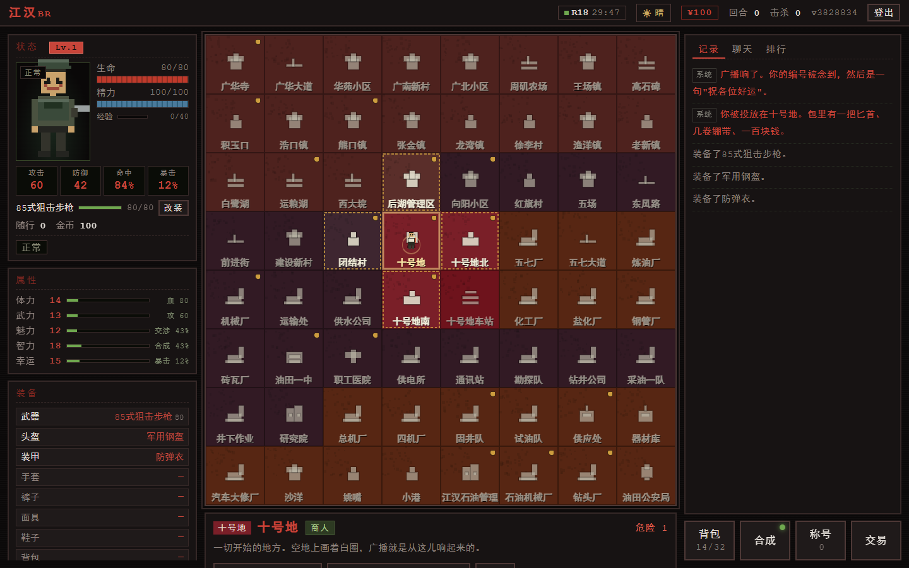
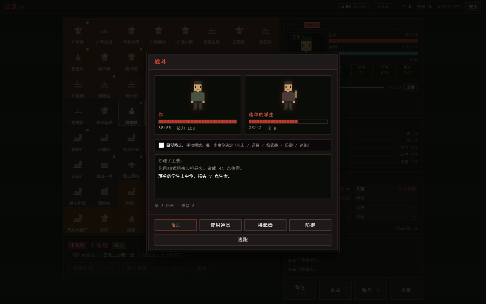
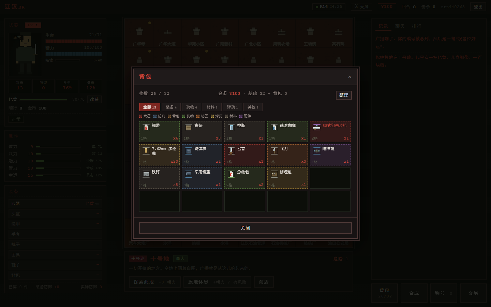
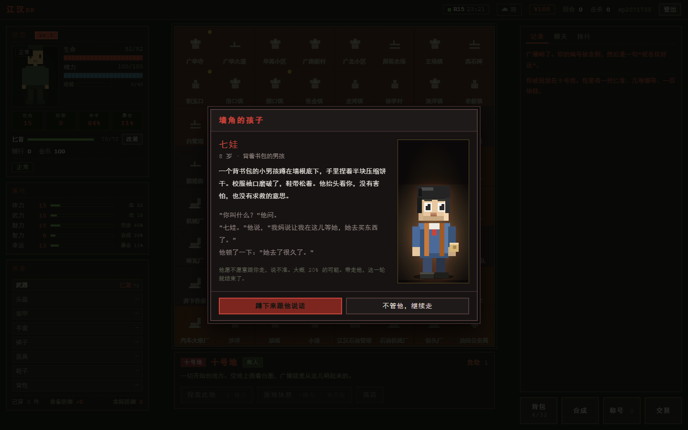
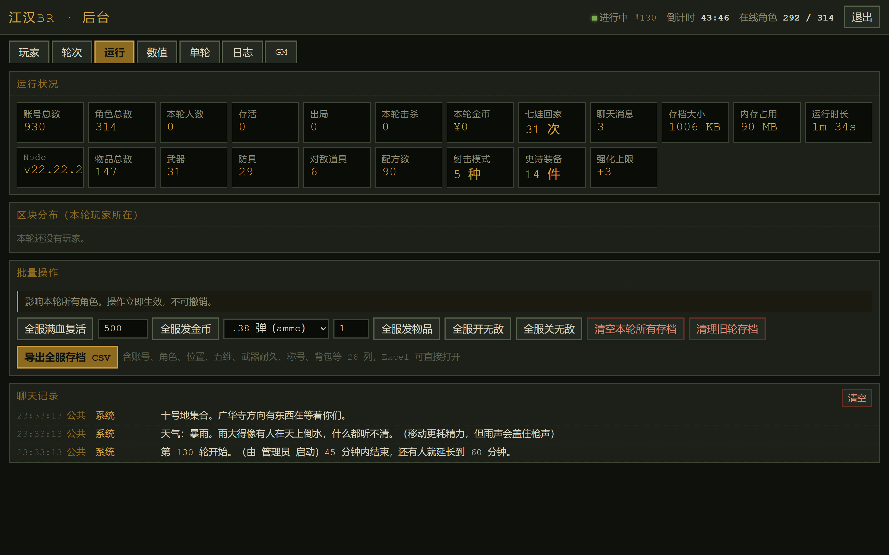

<div align="center">

# 江汉BR

**64 个区块，一个出口。**

复刻《大逃杀》设定的网页多人生存游戏，舞台搬到了江汉油田。<br>
零依赖 Node 后端 · 原生 Canvas 前端 · 全程序化像素美术

[](#快速开始)
[](#技术实现)
[](#已知限制)
[](#装备)
[](#称号)
[](#一局怎么玩)

</div>



<p align="center"><sub>三栏布局：左边是你的身体，中间是 64 个区块，右边是这个世界的声音</sub></p>

---

| 开始 | 玩法 | 成长 | 系统 |
|:---|:---|:---|:---|
| [这是什么](#这是什么)<br>[快速开始](#快速开始)<br>[一局怎么玩](#一局怎么玩)<br>[地图](#地图) | [核心循环](#核心循环)<br>[战斗](#战斗)<br>[属性与成长](#属性与成长) | [装备](#装备)<br>[合成](#合成)<br>[状态与天气](#状态与天气)<br>[特殊角色](#特殊角色) | [NPC 与交易](#npc-与交易)<br>[称号](#称号)<br>[排名](#排名)<br>[界面与操作](#界面与操作)<br>[后台](#后台) |

---

## 这是什么

> 广播念完你的编号，然后是一句「祝各位好运」。
>
> 你被投放在十号地。包里有一把匕首、几卷绷带、一百块钱。

一场被广播出来的死亡游戏。你是第 37 号，被丢进江汉油田的 64 个区块里，只有一个人能走出去。

| | |
|:---|:---|
| ✅ **是** | 网页多人局，一局 30 分钟；文字 + 弹窗驱动的回合制；多人同服会遇到真人；像素风，黑底暗红 |
| ❌ **不是** | 动作游戏，没有实时操作；3D，不需要显卡；单机离线；卡通可爱风 |

**三条胜利路线**，随便挑一条：

| 路线 | 怎么做 | 难度 |
|:---|:---|:---:|
| 🏆 **熬死所有人** | 活到最后，或者别人都死光 | ★★★ |
| 🔫 **杀掉广播员** | 第 30 分钟后上广华寺钟楼 | ★★★★ |
| 🧒 **带走七娃** | 说服那个 8 岁男孩跟你走 | ★ |

---

## 快速开始

```bash
node server.js
```

或者直接双击 `start.bat`。

| 入口 | 地址 | 说明 |
|:---|:---|:---|
| 🎮 游戏 | <http://127.0.0.1:8123> | 注册即玩，账号密码本地加盐哈希存储 |
| ⚙️ 后台 | <http://127.0.0.1:8123/admin.html> | 密码**首次启动随机生成**，见 `store/admin.json` 或启动日志 |

> [!NOTE]
> 环境只需要 Node，不需要 `npm install`。整个项目**没有一个第三方依赖**，`store/` 目录里全是纯 JSON，可以直接用编辑器改数值调试。

**开一局**：注册账号 → 输入角色名（最长 12 字）→ 第一个点「加入对局」的人会触发开轮。

**手机上玩**：同一局域网内用 `http://<你的电脑IP>:8123` 打开，768px 以下自动切单列布局。

---

## 一局怎么玩

一局 = 一轮。轮次结束所有角色作废，下一轮重新抽签。

```text
00:00  ── 开局，64 个区块，全员空手，100 块
  │
  │      移动 −4 精力 / 探索 −3 精力，每次掷一次事件
  │
30:00  ── 广播员出现在广华寺钟楼（前 30 分钟去只会看到空楼）
  │
45:00  ── 硬性结束，按排名结算
```

**四种结束方式**

| 方式 | 触发条件 |
|:---|:---|
| 🎯 击杀最终 BOSS | 谁先杀掉广播员谁赢，全场立即结束 |
| 🧒 带走七娃 | 成功说服那个男孩，本轮立即结束，算你赢 |
| 💀 全员出局 | 只剩一个人活着（或一个都不剩） |
| 🛠 管理员手动 | 后台「轮次」页 |

> [!IMPORTANT]
> 只有**血量归零**才会出局。精力见底不会死，但走不动也打不了——原地休息回 10~18 点，代价是有概率被人摸上来。

---

## 地图

8×8 共 64 个区块，区块名全部取自江汉油田真实地名。

| 片区 | 区块数 | 位置 | 色调 |
|:---|:---:|:---|:---|
| 广华 | 20 | 西北 | 暗红 |
| 向阳 | 20 | 中部 | 暗紫 |
| 五七 | 20 | 东南 | 赭橙 |
| 十号地 | 4 | 正中（出生地） | 亮红 |

**危险度按离十号地的曼哈顿距离递进**：出生地 1，相邻 2，往外 3/4，最边缘 5。越危险的地方掉落越好，敌人也越硬。

- 地图上标**金色圆点**的区块有商人（18 个）
- 当前格有呼吸描边，相邻格是金色虚线
- 空投落下时，区块信息栏会亮「空投」标记

**广华寺在地图西北角**——广播员就站在那座钟楼顶上。

---

## 核心循环

```text
点相邻格移动（−4 精力）  或  点当前格探索（−3 精力）
        ↓
   掷一次事件
        ↓
遭遇 / 人质 / 七娃 / 刘颖 / 宝箱 / 地雷 / 剧情 NPC / 无事
        ↓
   打赢了捡尸体上的东西
```

**事件权重**（归一化后随机，探索时部分事件加权）

| 事件 | 基础权重 | 探索时 |
|:---|:---:|:---:|
| ⚔️ 战斗 | `(18 + 危险度×4 − 幸运×0.1) × 遭遇倍率` | +6 |
| 🙋 人质 | 7 | +3 |
| 🧒 七娃 | 3（冷却期内为 0） | +1 |
| 💊 刘颖 | 4（药效期内为 0） | +1 |
| 📦 宝箱 | 10 | **22** |
| 💣 地雷 | `max(0, 4 + 危险度 − 幸运×0.05)` | — |
| 🧑‍🌾 剧情 NPC | 12 | −4 |
| 🌫 无事发生 | 25 | — |

> [!TIP]
> 探索比移动更容易出宝箱，但探索不换地方。安全区反复探索是前期攒装备最快的路子——危险度低，遭遇率也低。

---

## 战斗



<p align="center"><sub>左边是你，右边是那个落单的学生。下面那行字会说清楚谁打中了谁、掉了多少血</sub></p>

回合制。你的选项是：**攻击 / 使用道具 / 换武器 / 防御 / 逃跑**。

### 数值怎么算

```text
玩家命中 = clamp(82 + 幸运×0.12 + 配件命中 − 敌人闪避 + 状态加成, 15, 98)
玩家伤害 = 武器伤害 × (1 + 武力/150) × rand(0.85, 1.15) × 状态系数 × 100/(100 + 敌防×2.5)
暴击率   = 8 + 幸运×0.25 (%)
暴击伤害 = ×1.8

敌人命中 = clamp(70 − 玩家幸运×0.15 − 20(烟雾中), 20, 90)
敌人伤害 = 敌人攻击 × rand(0.85, 1.15) × 100/(100 + 玩家防御×2.5)
```

防御是**递减式减伤**，不是直接相减——所以永远不会有「完全免疫」，堆防御的收益是边际递减的。

### 自动攻击

战斗界面有个勾选框。勾上之后每 0.65 秒自动打一次，**血量低于 25% 自动停手**。不勾就每回合手动决定。

### 噪音会招人

冷兵器噪音 1~3，基本无声；枪械 8~10，全场都听得见。

| 战斗结束时噪音 | 立刻再来一波 |
|:---:|:---:|
| ≥ 10 | 50% |
| ≥ 6 | 22% |
| 最多连战 | 3 波 |

弓箭和弩噪音只有 1，不会触发连战。

> [!WARNING]
> **这是新手最容易忽略的一条**：拿枪打赢一场，往往意味着要连打三场，而你的血不会回。冷兵器慢，但它让你活着离开。

### 火器的射击模式

同一把枪不是只有一个数字，射击模式决定了它到底怎么打。

| 模式 | 每击发数 | 单发命中 | 总伤 | 命中 | 噪音 | 磨损 | 定位 |
|:---|:---:|:---:|:---:|:---:|:---:|:---:|:---|
| 单发 | 1 | 100% | 1.00 | +4 | 0 | ×1 | 火箭筒、信号枪 |
| 半自动 | 1 | 100% | 1.00 | **+8** | **−1** | ×1 | 打得准、省弹、打得久 |
| 点射 | 2 | 62% | 1.24 | −4 | 0 | ×1.5 | 折中 |
| 全自动 | 3 | 45% | **1.35** | **−12** | **+2** | ×2 | 总伤高，吃弹快，声音大 |
| 压制 | 4 | 36% | **1.44** | **−16** | **+3** | ×2.5 | 弹药黑洞，靠弹匣大撑 |

> [!WARNING]
> 全自动总伤最高，但一次打 3 发、弹匣两回合见底、命中还低 20 个点。**别只看伤害数字选枪。**

---

## 属性与成长

五维初始随机 **8~18**，上限 **100**。

| 属性 | 作用 | 实际产出 |
|:---|:---|:---|
| 💪 体力 | 血量上限 | `floor(55 + 体力×1.8)` |
| 🥊 武力 | 攻击倍率 | 攻击 = 武器伤害 ×(1 + 武力/150) |
| 🗣 魅力 | 交涉成功率 | 「放我一马」、人质带走 |
| 🧠 智力 | 合成成功率 | 智力 100 时合成必成 |
| 🍀 幸运 | 命中 / 暴击 / 掉落 / 逃跑 | 命中 +0.12/点，暴击 +0.25%/点 |

> [!CAUTION]
> **任一项到 100 后，其他属性永久无法再提升。** 系统会提示你。所以「先堆一项」是有代价的决定，不是无脑操作。

### 等级

```text
升级需求 = 20 + (等级−1) × 9      # Lv1→2 要 20，Lv29→30 要 272
上限 30 级，到顶后经验清零
每升一级：五维各 +2%（至少 +1），回 15 血、10 精力
```

| 击杀对象 | 经验 |
|:---|:---:|
| tier 1 | 15 |
| tier 2 | 30 |
| tier 3 | 50 |
| tier 4 | 75 |
| tier 5 | 110 |
| 最终 BOSS | 500 |
| **真人玩家** | **×2.5** |

---

## 装备



<p align="center"><sub>背包按类别着色，每个格子都是一个手绘的 24×24 像素图标</sub></p>

**137 件物品**，全部程序化绘制像素图标，不依赖任何图片文件。

| 类别 | 数量 | 类别 | 数量 |
|:---|:---:|:---|:---:|
| 🔪 武器 | 22 | 💊 药物 | 26 |
| 🛡 防具 | 29 | 🔫 弹药 | 12 |
| 🎒 背包 | 5 | 💣 暗器 | 9 |
| 🔩 材料 | 18 | 🎯 对敌道具 | 6 |
| 🔧 配件 | 6 | ✨ 特殊 | 4 |

### 武器

**冷兵器 11 把**（噪音 1~3，不招人）：

| 武器 | 伤害 | 噪音 | 武器 | 伤害 | 噪音 |
|:---|:---:|:---:|:---|:---:|:---:|
| 匕首 | 14 | 1 | 长矛 | 17 | 1 |
| 砍刀 | 18 | 2 | 弓 | 16 | 1 |
| 消防斧 | 22 | 3 | 弩 | 24 | 1 |
| 棒球棍 | 15 | 3 | 弹弓 | 7 | 1 |
| 铁锤 | 20 | 3 | 鱼叉 | 17 | 1 |
| 电击棍 | 15 | 2 | | | |

**火器 11 把**（一个类别一个场景一把，全部现实存在的型号）：

| 枪 | 伤害 | 弹药 | 模式 |
|:---|:---:|:---|:---|
| 92式手枪 | 22 | 9mm | 半自动 |
| 54式手枪 | 24 | 7.62mm 手枪弹 | 半自动 |
| 左轮手枪 | 26 | .38 | 半自动 |
| 双管猎枪 | 45 | 12号霰弹 | 半自动 |
| 79式冲锋枪 | 24 | 7.62mm 手枪弹 | 点射 |
| 56式半自动步枪 | 35 | 7.62mm 步枪弹 | 半自动 |
| 95式自动步枪 | 36 | 5.8mm | 全自动 |
| 88式狙击步枪 | 50 | 5.8mm | 半自动 |
| 95式班用机枪 | 38 | 5.8mm | 压制 |
| 40 火箭筒 | 120 | 火箭弹 | 单发 |
| 信号枪 | 10 | 信号弹 | 单发 |

> [!NOTE]
> **高级武器和防具在商人那里买不到**，只能从别人身上拿。这是整个游戏的资源分配逻辑：商人给你续命的东西，好东西得自己去抢。

### 防具

29 件，6 个部位：

| 部位 | 入门 | 顶配 |
|:---|:---|:---|
| ⛑ 头盔 | 安全帽 3 | 凯夫拉头盔 22 |
| 🥋 装甲 | 棉袄 4 | 外骨骼护甲 **58** |
| 🧤 手套 | 劳保手套 2 | 战术手套 9 |
| 👖 裤子 | 牛仔裤 4 | 战术裤 14 |
| 😷 面具 | 口罩 1 | 战术面罩 13 |
| 👟 鞋子 | 布鞋 2 | 战术靴 12 |

### 背包

基础 **32 格**，靠背包往上加：

| 背包 | 额外格数 | 总容量 |
|:---|:---:|:---:|
| 布袋 | +8 | 40 |
| 帆布包 | +20 | 52 |
| 登山包 | +40 | 72 |
| 军用背包 | +60 | 92 |
| 战术背囊 | +100 | **132** |

### 耐久

攻击时不管中没中都磨损。

| 类型 | 最大耐久 | 每次消耗 |
|:---|:---:|:---:|
| 火箭筒 | 3 | 1 |
| 冷兵器 | 70 | 1 |
| 狙击枪 | 80 | 2 |
| 手枪 / 步枪 / 冲锋枪 / 霰弹 | 100 | 2 |
| 机枪 | 150 | 3 |

耐久归零武器报废，攻击自动改徒手——**不会卡住**。修法两条：

- **修理包** +40 耐久（废铁 + 弹簧 + 胶带）
- 找广南新村的**修车的老韩**，40 块修满（比修理包划算）

### 改装

只有火器能改，三个通用槽：

| 槽位 | 配件 | 效果 |
|:---|:---|:---|
| 🔭 瞄具 | 瞄准镜 | 命中 +12 |
| 🔇 枪口 | 消音器 | 噪音 −6 |
| 🎯 握把 | 战术握把 | 伤害 +8% |

换武器或卸下时配件**自动拆回背包**，不会丢。

### 强化

同种装备两件合一件，+0 → +1 → +2 → +3。

```text
+1  数值 +10%（至少 +1 点）        例：安全帽 3 → 4
+2  + 随机 1 条属性词条（3~6 点）
+3  保留 +2 的词条，再补 1 条（5~10 点）
```

品质标签：`+1 优秀` → `+2 史诗` → `+3 传说`。词条只算**装备中**的那件，塞背包不叠加。

> [!TIP]
> 强化会优先拿**你正在穿的那件**当底，背包里的同类当材料消耗掉。所以背包里点「强化」时，被强化的可能是身上那件——详情区会写清楚。

---

## 合成


<p align="center"><sub>每一行都告诉你：缺什么、成功率多少、材料够不够</sub></p>

**80 条配方**，全部是「小 → 大」的升级路线，没有碎片化材料。

| 分类 | 条数 | 路线示例 |
|:---|:---:|:---|
| 🔪 武器 | 21 | 匕首 → 棒球棍 → 铁锤 → 砍刀 → 长矛 → 消防斧 → … → 火箭筒 |
| 🛡 防具 | 20 | 初级 6 / 中级 5 / 高级 6 / 传说 2 / 史诗 1 |
| 🔫 弹药 | 12 | 钢珠、箭矢、9mm、5.8mm、12号霰弹、火箭弹…全部可造 |
| 💣 暗器 | 8 | |
| 💊 医疗 | 7 | 绷带 → 止血带（绷带×2）→ 急救包（止血带×2 + 草药） |
| 🔧 配件 | 7 | 瞄准镜 / 消音器 / 战术握把 |
| 🎒 背包 | 5 | 布袋 → 帆布包 → 登山包 → 军用背包 → 战术背囊 |

```text
成功率 = clamp(30 + 智力×0.7 − 配方难度×8, 5, 100)
智力 100 → 必成
失败 → 材料全毁
```

**材料只有 18 种**（布条 / 木板 / 铁钉 / 胶带 / 空瓶 / 火药 / 电池 / 铜线 / 弹簧 / 钢管 / 绳子 / 废铁 / 皮革 / 玻璃片 / 螺丝 / 医用酒精 / 草药 / 木炭），前中后期都有用，不会捡到一辈子用不上的垃圾。

### 红点提示

材料凑齐、智力够的时候，「合成」按钮右上角会亮一个小圆点：

- 🔴 **红点** = 能合成装备类（武器 / 防具 / 背包 / 配件）
- 🟢 **绿点** = 只能合成消耗类（医疗 / 暗器 / 弹药）

鼠标停上去会浮出清单，告诉你具体能做什么。

> [!WARNING]
> 背包放不下时合成会**先退材料再失败**，不会出现「材料没了、东西也没了」。如果按钮写着「背包满」，那就是真的差格子。

---

## 状态与天气

### 状态

同时只保留一个，新状态覆盖旧状态，每个持续 **5 分钟**。

| 状态 | 效果 | 怎么获得 |
|:---|:---|:---|
| 🍺 喝醉了 | 防御 ×1.5，攻击 ×0.7，命中 −10 | 二锅头 |
| ☕ 非常清醒 | 防御 ×1.25，攻击 ×1.25，命中 +8 | 黑咖啡 |
| ☠️ 中毒了 | 每次移动/探索，血量与精力各 −20% | 毒蘑菇 |
| ❄️ 冷冻麻痹 | 10 秒不能移动，防御 ×0.9，攻击 ×0.8 | 液氮罐 |
| ⚪ 正常 | — | 默认 |

解除：**解毒剂**（中毒）、**醒酒汤**（醉酒）、**万能解药**（清所有状态）。

### 天气

全局天气，每 7~10 分钟自动切换并广播。

| 天气 | 影响 |
|:---|:---|
| ☀️ 晴 / ☁️ 阴 | 无 |
| 💨 大风 | 攻击 ×0.9，命中 −8，声音传得更远 |
| 🌧 暴雨 | 移动精力 ×1.4，命中 −5，雨声盖住枪声 |
| 🌫 大雾 | 命中 −15，遭遇率 ×0.7 |
| 🏜 沙尘 | 攻击 ×0.95，命中 −10，移动精力 ×1.2 |

天气同时影响**实际战斗**和**界面显示的数值**——你看到的就是打出来的。

### 空投

每 7~11 分钟随机一个区块掉补给箱，全服广播位置。**5 分钟内**到那个区块探索，必出一次宝箱。

---

## 特殊角色

<table>
<tr>
<td width="50%" align="center"></td>
<td width="50%" align="center"></td>
</tr>
<tr>
<td align="center"><sub><b>七娃</b> · 20% 概率跟你走</sub></td>
<td align="center"><sub><b>刘颖</b> · 红药丸，还是蓝药丸</sub></td>
</tr>
</table>

### 七娃

> 一个背书包的小男孩蹲在墙根底下，手里捏着半块压缩饼干。校服袖口磨破了，鞋带松着。他抬头看你，没有害怕，也没有求救的意思。
>
> 「你叫什么？」他问。
>
> 「七娃。」他说，「我妈说让我在这儿等她，她去买东西了。」
>
> 他顿了一下：「她去了很久了。」

8 岁。跟他说话有 **20%** 概率愿意跟你走——**带走他，本轮立即结束，算你赢**。

失败他会换个地方，过一会儿还能再遇到。同一账号累计带走 **10 次**解锁称号「好爸爸」（跨轮次累计）。

### 刘颖

> 一个女人站在路中间，穿一件洗得发白的外套。她的脸一半在路灯下，一半在阴影里，看不出年纪。
>
> 她抬起手，掌心躺着两颗药丸，一颗红，一颗蓝。
>
> 「红药丸，还是蓝药丸？」

| | 红药丸 | 蓝药丸 |
|:---|:---|:---|
| 影响 | 体魄类 | 心智类 |
| 属性 | 体力 / 武力 / 魅力 | 魅力 / 智力 / 幸运 |

- 随机影响 **1~3 个属性**，每个 ±5~20，**持续 10 分钟**
- 答对题：负向概率 30% · 答错：负向概率 80%
- 药效期间不会再遇到她

### 人质

遭遇战时可能撞见敌人守着一个人。打赢后可以问她愿不愿意跟你走。

**结果用表情给，不用文字先说**：问完之后她先低头沉默，1.3 秒后表情变化——**眼睛亮起来**就是同意，**头低下去、闭眼**就是拒绝。然后才出文字。

带走的人会跟着你，心情分开心 / 一般 / 不开心，休息时可能触发后续事件。累计带走 10 个解锁「人质救星」。

---

## NPC 与交易

### 8 个常驻 NPC

固定待在特定区块，可以反复交谈。每次 +1 好感，有 3~5 回合冷却（防刷）。好感达到阈值会主动给你东西。

| 位置 | NPC | 卖什么 |
|:---|:---|:---|
| 广南新村 | 修车的老韩 | 修武器、修理包、配件 |
| 五场 | 小学老师 | 情报、地图、医疗 |
| 五七厂 | 五七厂的女工 | 瞄准镜、消音器 |
| 龙湾镇 | 龙湾的老中医 | 解毒剂、万能解药 |
| 采油一队 | 采油工 | 各类弹药 |
| 化工厂 | 化工厂的疯子 | 炸弹、闪光弹 |
| 姚嘴 | 渡口的老船夫 | 止血带、对讲机 |
| 油田公安局 | 看守 | 子弹、防刺服（好感要求高） |

### 商店

18 个区块有商人，只卖基础物资（22 种商品）：绷带、止痛药、能量饮料、材料、布袋、箭矢、状态道具。收购价是原价的 **40%**。

### 玩家交易

只能和**同一区块**的玩家交易，报价式：

1. 打开交易面板，选这个区块里的玩家
2. 左边放你给的东西 + 金币，右边放你要对方给的东西 + 金币
3. 发送报价，对方点接受，双方物品和金币立即交换

报价 5 分钟有效。任意一方离开区块或物品不足，交易自动取消。

---

## 称号

**53 个称号**，分 6 类，在「称号」面板按分类查看，排行榜上会亮出来。

| 分类 | 数量 | 举例 |
|:---|:---:|:---|
| 🧭 通用 | 10 | 初次登场、万元户、三十而立、五边形战士、非人哉 |
| ⚔️ 战斗 | 11 | 新手猎人、百人斩、要害专家、赤手空拳、油田之王 |
| 🌱 生存 | 7 | 不死鸟、马拉松、满载而归、全副武装、油尽灯枯 |
| 📖 剧情 | 12 | 第一个人、人质救星、十全十美、带他回家、好爸爸、人脉 |
| 🔮 神秘 | 7 | 一杯倒、剧毒之身、冻成冰、锦鲤、五毒俱全 |
| 🎖 特色 | 6 | 拾荒之王、军火商、炼金术士、交易达人、和平主义者 |

<details>
<summary><b>展开全部 53 个称号</b></summary>

| 称号 | 分类 | 条件 |
|:---|:---:|:---|
| 初次登场 | 通用 | 移动 1 次 |
| 老油条 | 通用 | 累计移动 100 次 |
| 万元户 | 通用 | 累计赚到 3000 金币 |
| 大客户 | 通用 | 累计购买 30 次 |
| 出货王 | 通用 | 累计出售 30 次 |
| 手艺人 | 通用 | 合成成功 50 次 |
| 三十而立 | 通用 | 达到 30 级 |
| 五边形战士 | 通用 | 五维属性全部达到 100 |
| 钢铁之躯 | 通用 | 五维属性总和达到 300 |
| 非人哉 | 通用 | 五维属性总和达到 400 |
| 新手猎人 | 战斗 | 击杀 1 名敌人 |
| 十人斩 | 战斗 | 累计击杀 10 名敌人 |
| 二十五人斩 | 战斗 | 累计击杀 25 名敌人 |
| 刽子手 | 战斗 | 累计击杀 50 名敌人 |
| 百人斩 | 战斗 | 累计击杀 100 名敌人 |
| 要害专家 | 战斗 | 累计打出 50 次暴击 |
| 拳头说话 | 战斗 | 徒手击杀 1 名敌人 |
| 赤手空拳 | 战斗 | 徒手击杀 5 名敌人 |
| 残血不倒 | 战斗 | 生命 ≤5 时依然活着 |
| 裸装硬汉 | 战斗 | 不穿任何防具的情况下击杀 5 人 |
| 油田之王 | 战斗 | 击杀最终 BOSS |
| 不死鸟 | 生存 | 单局存活 30 回合 |
| 长跑者 | 生存 | 单局存活 60 回合 |
| 马拉松 | 生存 | 单局存活 80 回合 |
| 满载而归 | 生存 | 背包格数用满 |
| 全副武装 | 生存 | 六个部位全部装备防具 |
| 神兵利器 | 生存 | 装备一把稀有度 5 的武器 |
| 油尽灯枯 | 生存 | 精力 ≤5 时依然活着 |
| 第一个人 | 剧情 | 带走 1 名女性人质 |
| 人质救星 | 剧情 | 累计解救 10 名女性人质 |
| 第一次当爹 | 剧情 | 累计生下 1 个孩子 |
| 十全十美 | 剧情 | 累计生下 10 个孩子 |
| 带他回家 | 剧情 | 第一次带走七娃 |
| 第三次 | 剧情 | 累计 3 次带七娃回家（跨轮次） |
| 第五次 | 剧情 | 累计 5 次带七娃回家（跨轮次） |
| 好爸爸 | 剧情 | 累计 10 次带七娃回家（跨轮次） |
| 红蓝之间 | 剧情 | 遇到刘颖 1 次 |
| 她的老朋友 | 剧情 | 遇到刘颖 5 次 |
| 人脉 | 剧情 | 和全部 8 个常驻 NPC 交谈过 |
| 老熟人 | 剧情 | 任意 NPC 好感度达到 10 |
| 一杯倒 | 神秘 | 进入醉酒状态 1 次 |
| 酒鬼 | 神秘 | 进入醉酒状态 5 次 |
| 剧毒之身 | 神秘 | 进入中毒状态 |
| 冻成冰 | 神秘 | 进入冻结状态 |
| 清醒 | 神秘 | 进入清醒状态 |
| 锦鲤 | 神秘 | 幸运达到 50 |
| 五毒俱全 | 神秘 | 解锁醉酒 / 中毒 / 冻结 / 清醒四个状态称号 |
| 拾荒之王 | 特色 | 背包里同时有 20 种不同物品 |
| 军火商 | 特色 | 同时携带 5 把火器 |
| 炼金术士 | 特色 | 合成成功 20 次 |
| 全能选手 | 特色 | 合成、购买、出售、交易各至少 1 次 |
| 交易达人 | 特色 | 完成 10 次玩家交易 |
| 和平主义者 | 特色 | 存活 30 回合且击杀为 0 |

</details>

---

## 排名

排名 = 存活 + 成长 + 本轮成就，击杀只是其中一项。

```text
存活分（回合×0.8，上限 50）+ 等级×8 + 本轮称号×10 + 击杀×5
+ 探索×0.4 + 合成×3 + 金币÷50 + 存活奖励 30

额外：击杀 BOSS +150 · 本轮带七娃回家 +400 · 每个孩子 +5 · 每个人质 +6
```

| 项 | 权重 | 为什么这么给 |
|:---|:---:|:---|
| 存活 | 0.8，上限 50 | 必须封顶，否则挂机躲着就能刷 |
| 等级 | 8 | 本轮成长 |
| 称号 | 10 | **只算本轮拿到的**，跨轮里程碑不计分 |
| 击杀 | 5 | 从 10 降下来，不再是绝对主项 |
| 探索 | 0.4 | 新手打不过老兵，但探索做得到 |
| 合成 | 3 | 同上，且必须动起来才有 |
| 金币 | 0.02 | 50 块 = 1 分 |
| 存活奖励 | 30 | 活到最后 |

> [!NOTE]
> 设计目标是让「老兵杀神」和「新手谨慎」的差距从 4.1 倍压到 2.3 倍，开局双方都是 40 分，没有任何白给的分。

---

## 界面与操作

```text
┌──────────┬─────────────────────┬──────────┐
│ 状态     │                     │ 记录     │
│ 属性     │   地图 672×672      │ 聊天     │
│ 装备     │   + 区块信息按钮    │ 排行     │
└──────────┴─────────────────────┴──────────┘
```

窗口小于 1080px 自动上下堆叠，地图排最上面；小于 768px 走移动端单列，弹窗变底部抽屉。

### 键盘操作

整套连起来可以完全不碰鼠标：

| 键 | 作用 |
|:---|:---|
| <kbd>Enter</kbd> | 探索 |
| <kbd>B</kbd> / <kbd>M</kbd> | 背包 / 合成 |
| <kbd>↑</kbd> <kbd>↓</kbd> <kbd>←</kbd> <kbd>→</kbd> | 弹窗内选择 |
| <kbd>空格</kbd> | 确定（遭遇 → 战斗，战斗 → 攻击） |
| <kbd>Esc</kbd> | 关闭浮层 |

连招：<kbd>Enter</kbd> 探索 → 出遭遇 → <kbd>空格</kbd> 战斗 → <kbd>空格</kbd> 攻击，直到战利品。

### 一些好用的细节

- **道具悬浮**：鼠标停在背包 / 装备 / 商店 / 战利品 / 宝箱 / 合成 / 交易里任何物品上，都会显示详细数值，**并和当前穿戴的同类装备对比**（绿色 `↑` 更好，红色 `↓` 更差）
- **背包分类**：全部 / 装备 / 药物 / 材料 / 弹药 / 其他，按类别着色
- **双击**：背包里双击直接生效——装备类穿上，消耗类用一个
- **批量使用**：药物点开后拖滑块，一次吃 N 个，按钮实时显示「使用 N 个」
- **整理**：一键把同类物品排到一起，稀有度高的在前
- **升级绿点**：背包里比身上强的装备，格子右上角闪绿点
- **可强化黄标**：凑够两件同种同级的装备时，格子亮黄框

---

## 聊天与 GM

三个频道：

| 频道 | 谁能看到 | 怎么发 |
|:---|:---|:---|
| 📢 公共 | 全服 | 默认频道 |
| 📍 区块 | 同区块的人 | 切到「区块」 |
| 💬 私聊 | 一对一 | 输入 `@玩家ID 内容` |

系统消息（开局、死亡、交易、空投、BOSS 出现、GM 操作）自动广播到公共频道。

### GM 命令

只有绑定了 GM 的账号能用，在聊天框直接输入：

```text
@//gm/ show me the money        金币 +10000
@//gm/ god bless you            切换无敌（免疫一切伤害）
@//gm/ give me 绷带 5            获得物品，不给数量默认 1 件
@//gm/ give me 火箭筒
@//gm/ help                     列出全部命令
```

物品名支持中文名、英文 id、模糊匹配。

---

## 后台



<p align="center"><sub>16 项运行指标、区块热力条、批量操作、聊天记录，全在一页</sub></p>

`/admin.html`，五个页签：

| 页签 | 能干什么 |
|:---|:---|
| 👤 **玩家** | 改血量 / 精力 / 金币 / 位置 / 五维 / 无敌，背包增删任意物品 |
| 🔄 **轮次** | 开始 / 提前结束 / 全服广播 / 历史榜单 / 手动空投 |
| 📊 **运行** | 16 项运行指标、区块热力条、批量操作、聊天记录、日志页、导出 CSV |
| 🎚 **数值** | 14 个参数即时生效：掉落倍率、金币倍率、商人价格、初始金币、移动/探索消耗、状态时长、七娃概率、遭遇倍率、地雷伤害、BOSS 血量与攻击、是否启用 BOSS、玩家可否自动开轮 |
| 🛠 **GM** | 命令手册、代发命令、GM 账号绑定 |

**导出**：玩家在背包底部导出自己的存档 CSV，后台可导出全服。26 列，带 UTF-8 BOM，Excel 直接打开不乱码。

---

## 技术实现

<details>
<summary><b>展开文件结构与技术细节</b></summary>

```text
server.js              HTTP 服务 + 账号 + 轮次 + 聊天 + 交易 + GM + 后台 API
game.js                全部游戏逻辑（移动 / 事件 / 战斗 / 状态 / 合成 / 强化 / 商店 / 人质）
world.js               轮次状态机、聊天存储、全局设置
trade.js               玩家交易（内存态）
data/
  map.js               64 区块
  items.js             137 件物品
  recipes.js           80 条配方
  enemies.js           20 种敌人 + 5 档掉落表
  weather.js           6 种天气
  status.js            5 种状态
  special.js           七娃、刘颖、12 道题
  npcs.js              8 个常驻 NPC
  achievements.js      53 个称号
  shop.js              22 种商品 + 18 个商人
  boss.js              最终 BOSS「广播员」
public/
  index.html           游戏页骨架
  app.js               全部前端逻辑
  pixel.js             像素美术（全程序化，无图片资源）
  style.css            暗色废土 + 像素硬边框
  admin.html           后台（单文件）
docs/img/              README 配图
```

**技术约束**（不是建议，是硬规矩）

1. 零依赖——只用 Node 内置模块，不许 `npm install`
2. 前端无框架无构建——原生 JS + Canvas，`<script src>` 直接引
3. 存储只用 JSON 文件——不许数据库
4. 数值必须走配置——可调数值从 `settings` 读，不许写死

**性能**

存储层是内存优先：启动时全量载入 `Map`，运行期读写全走内存，磁盘只做每 2 秒批量落盘。

| 指标 | 优化前 | 优化后 |
|:---|:---:|:---:|
| 30 人并发 150 请求 | 25152ms / 6 req/s | **288ms / 521 req/s** |
| P50 | 12758ms | **189ms** |
| 首屏资源 | 282KB | **79KB**（gzip + 内容哈希版本号） |

**测试**：九套，全绿才算改完。

```bash
node test.js        # 数据完整性 + 20 局平衡模拟
node test2.js       # 人质 / 生育 / 成就 / BOSS / 无敌 / 金币
node test3.js       # 状态 / 七娃 / 刘颖 / 掉落引用
node test4.js       # 耐久 / 改装 / NPC / 合成 / 强化 / 射击模式
node api-test2.js   # 轮次 / 商店 / 聊天 / GM / 交易 / 后台
node api-test3.js   # 后台统计 / 批量操作 / 代发 GM
node api-test4.js   # NPC 接口 / 改装接口 / CSV 导出
node pvp-test.js    # 玩家对战
node ui-test.js     # 界面状态机（需 playwright-core）
```

</details>

---

## 已知限制

- 🚧 剧情主线还没做，目前是纯生存沙盒 + 两条特殊结局
- 🔧 武器改装只有三个通用槽，没有口径 / 枪管 / 弹匣细分
- 💾 只能导出存档，不能导入
- 📱 移动端只做了竖屏，横屏未针对性优化
- 🎨 立绘只有一套基础体型，没有更多外形区分
- 🖥 单进程单端口，没有多进程 / 集群

---

<div align="center">

**开发文档**：[README](README.md) · [AI 上下文](AI_CONTEXT.md) · [开发日志](DEVLOG.md) · [部署说明](README-DEPLOY.md)

<sub>广播员还在钟楼上念编号。你是第 37 号。</sub>

</div>
